
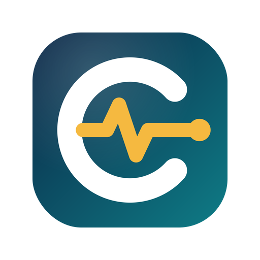

<h1 align="center">CEISA Monitor 2.0</h1>

Pantau status dokumen pabean di portal CEISA 4.0 dalam satu dasbor. 
Ringkasan, Jalur Merah dalam pemeriksaan, tindak lanjut, laporan per penanggung jawab, presentasi rapat, laporan resmi A4, Excel, dan WhatsApp.

<a href="https://chromewebstore.google.com/detail/iojgnclbfhgoapolmfgcjkphacdfjbgi"><b>Pasang dari Chrome Web Store</b></a> ·
<a href="docs/PANDUAN.md">Panduan bergambar</a> ·
<a href="docs/TUTORIAL.md">Video tutorial</a> ·
<a href="docs/ALUR_KERJA.md">Alur kerja</a> ·
<a href="docs/FAQ.md">Tanya jawab</a> ·
<a href="SECURITY.md">Keamanan</a> ·
<a href="#english">English</a>

<b>Versi 2.0.0</b> · Chrome dan Edge · Bahasa Indonesia · Gratis · Tidak resmi, tidak berafiliasi dengan DJBC

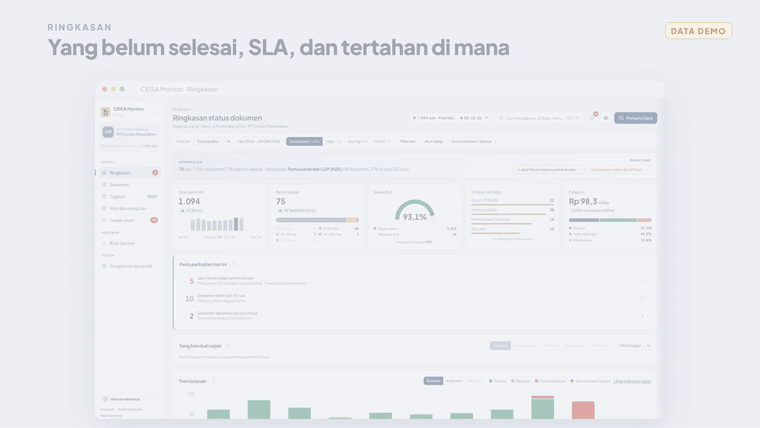

<a href="../../releases/tag/v2.1.0">Tonton video perkenalan (39 detik)</a> · semua gambar dan video memakai data fiktif berlabel DATA DEMO

## Mengapa CEISA Monitor

Status dokumen, billing, dan NTPN ada di portal CEISA 4.0, tetapi tersebar di beberapa halaman. Untuk laporan, datanya disalin ke Excel dan disusun ulang, lalu tugas untuk tim diketik satu per satu ke WhatsApp. CEISA Monitor membaca data dengan sesi login Anda sendiri dan mengolahnya langsung di browser, tanpa server.

| Pekerjaan | Cara biasa | Dengan CEISA Monitor |
|---|---|---|
| Melihat status semua dokumen | Membuka Daftar Dokumen, menyaring jenis demi jenis | Halaman Ringkasan: belum selesai, Sesuai SLA, umur dokumen, dan di status mana dokumen tertahan |
| Menentukan prioritas hari ini | Mencari sendiri dokumen yang bermasalah | "Perlu perhatian hari ini": Jalur Merah dalam pemeriksaan, dokumen lebih dari 30 hari, dokumen yang dipantau |
| Menugaskan tim | Mengetik pesan WhatsApp per orang | Laporan per penanggung jawab: pesan WhatsApp dan Excel per orang, hasilnya diimpor kembali |
| Menyusun laporan rapat | Menyalin data ke Excel dan PowerPoint | Pilih tujuan (Rapat bulanan, Kabar harian, Arsip dan audit, Tugas tim); berkas jadi dalam hitungan detik |
| Menghitung pungutan | Membuka dokumen satu per satu | Nilai dan pungutan dari isi dokumen: dibayar, fasilitas, per bulan, per jenis |
| Membagikan contoh ke pihak luar | Menghapus identitas satu per satu | Pilihan Samarkan identitas pada semua keluaran |

**Untuk siapa:** staf dan supervisor ekspor-impor, PPJK yang menangani banyak klien, serta pengelola kawasan berikat dan KEK.

**Dibuat oleh** Trias Purwantoro, praktisi ekspor-impor dan Ahli Kepabeanan bersertifikat, sebagai proyek independen yang dipakai dan diperbaiki dari pekerjaan sehari-hari. Kritik dan usul fitur disampaikan lewat [Issues](../../issues/new/choose).

## Yang baru di 2.0

- **Tampilan baru per pekerjaan:** Ringkasan, Dokumen, Tagihan, Nilai dan pungutan, Tindak lanjut, Buat laporan, serta Pengaturan dan profil. Setiap halaman diawali kesimpulan singkat.
- **Perlu perhatian hari ini.** Jalur Merah dihitung hanya selama masih dalam pemeriksaan (Penjaluran/Siap Jalur, Pemeriksaan Fisik/Barang, Penerimaan Dokumen Pelengkap). Aturan yang sama berlaku di dasbor dan semua laporan.
- **Dokumen NPWP 15 digit ikut ditarik** dan digabung ke akun yang sama. Dokumen lama (belum final lebih dari setahun) dipisahkan dari angka utama dan dapat ditampilkan bila perlu.
- **Buat laporan dimulai dari tujuan.** Presentasi rapat sekitar 15 slide dengan judul berupa kesimpulan, laporan resmi A4 dengan ikhtisar halaman pertama, Excel berformat, dan pesan WhatsApp versi Singkat atau Lengkap.
- **Laporan per penanggung jawab:** pesan WhatsApp dan Excel per orang. Kolom Hasil yang diisi tim dapat diimpor kembali menjadi status dan catatan tindak lanjut.
- **Panel dokumen:** tahapan dari Riwayat Status portal, lama di setiap status, isi dokumen, pungutan, tindak lanjut, dan billing dalam satu tempat.
- **Pemantauan (pilihan, mati secara bawaan):** perubahan status masuk ke kotak masuk di lonceng, dengan pemberitahuan browser bila diizinkan.
- **Lebih ringan untuk data besar:** Perbarui data dan Ambil isi dokumen berjalan di latar belakang; dasbor puluhan ribu dokumen terbuka dalam hitungan detik.
- **Mode layar kantor**, tema gelap, tampilan ponsel, dan halaman Kesehatan.

Pengguna versi 1 diperbarui otomatis oleh Chrome. Data, tindak lanjut, dan pengaturan tetap ada; cadangan otomatis dibuat sebelum pembaruan. Tampilan English belum tersedia di 2.0 dan menyusul di versi berikutnya. Rincian perubahan ada di [CHANGELOG](CHANGELOG.md).

## Lihat cara kerjanya

| Ringkasan | Perlu perhatian hari ini |
|---|---|
| 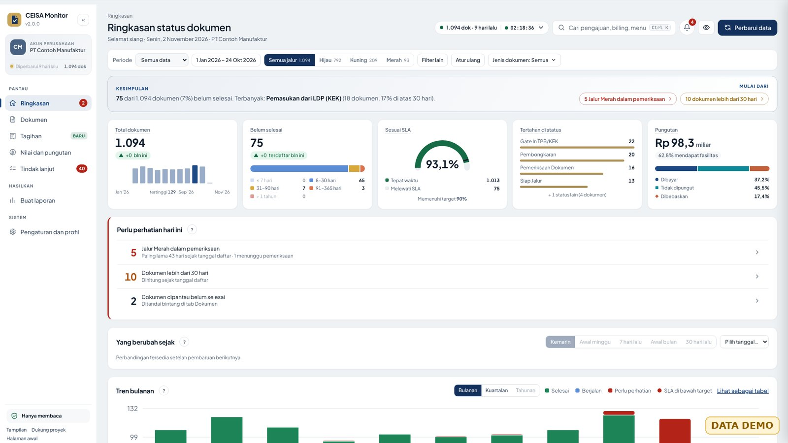 | 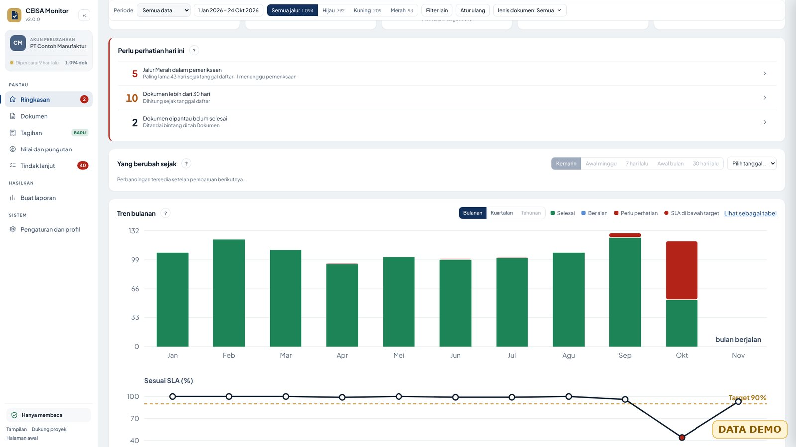 |
| **Buat laporan: mulai dari tujuan** | **Laporan per penanggung jawab** |
| 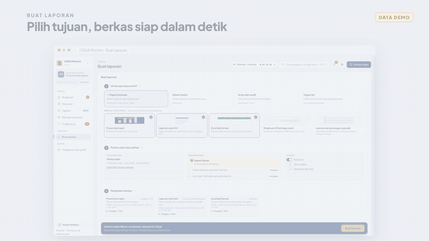 | 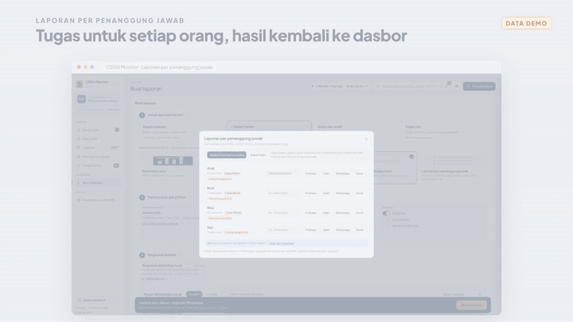 |
| **Panel dokumen** | **Nilai dan pungutan** |
| 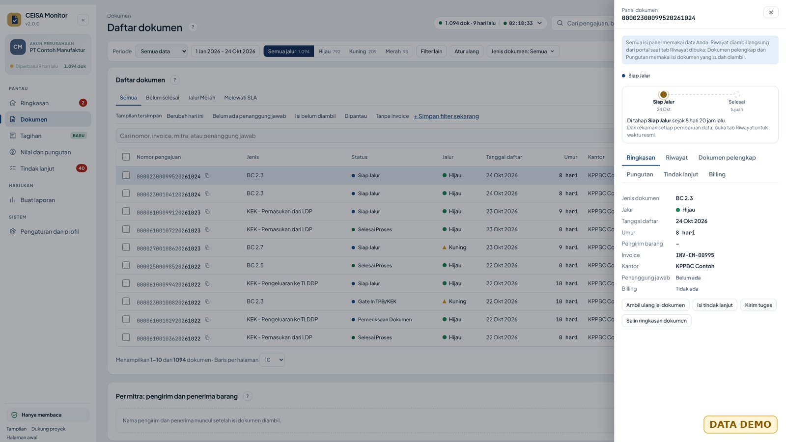 | 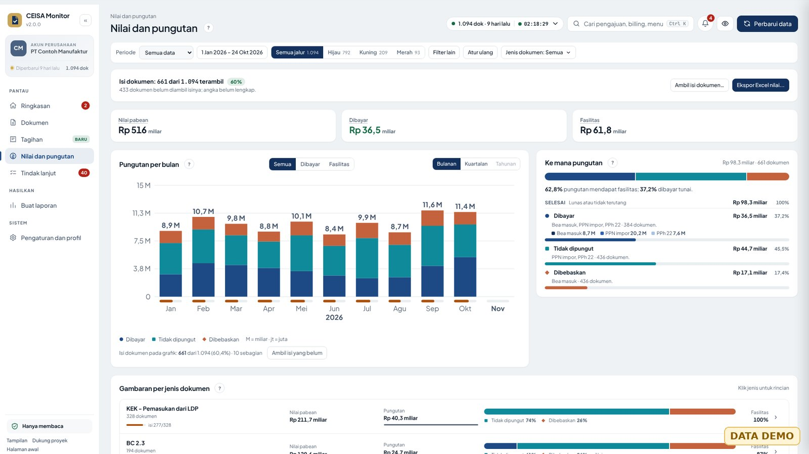 |
| **Presentasi rapat** | **Laporan resmi A4** |
| 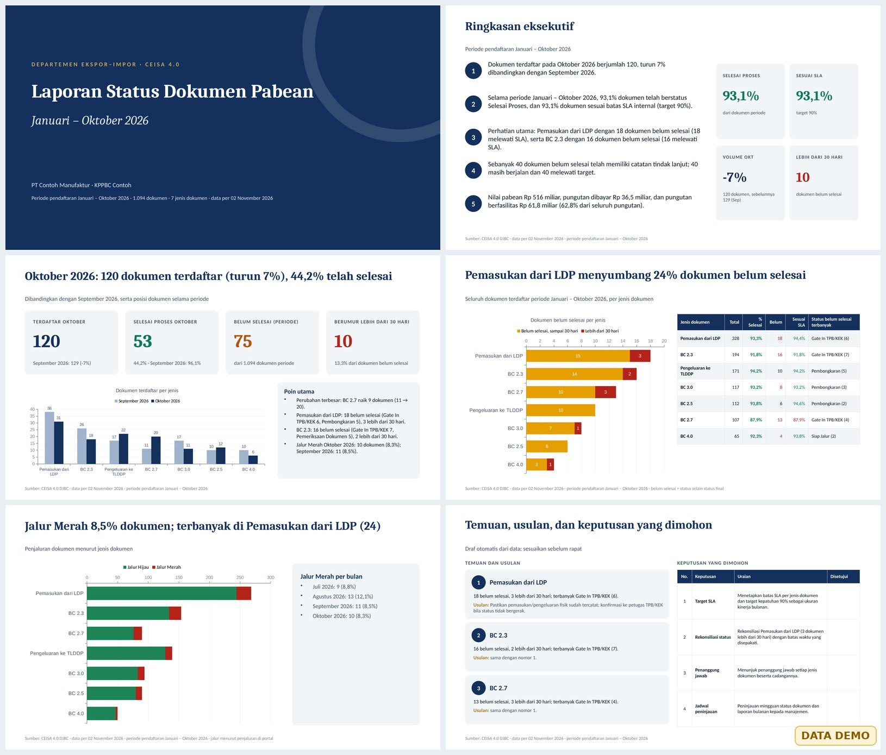 | 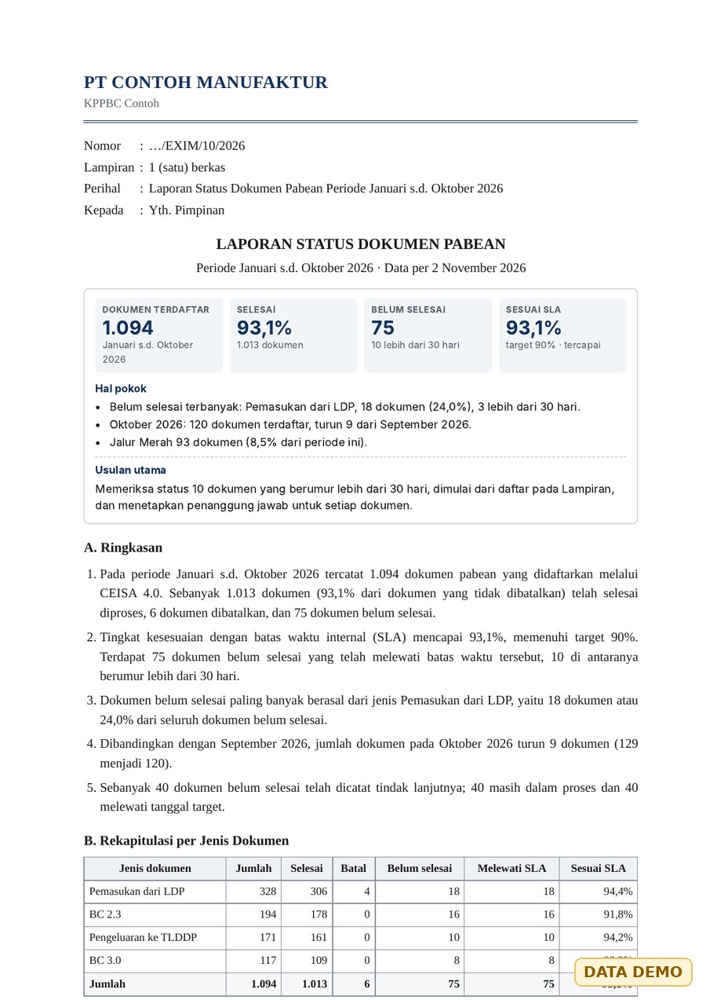 |
| **Pesan WhatsApp** | **Tindak lanjut** |
| 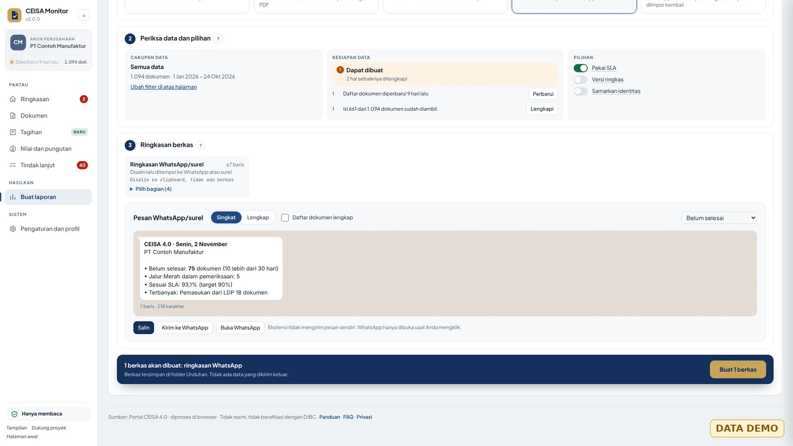 | 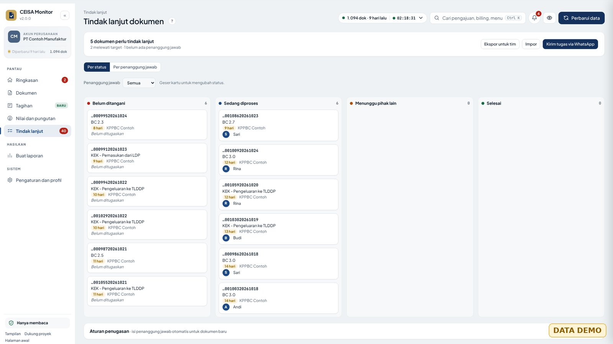 |

Video tutorial per bab ada di [docs/TUTORIAL.md](docs/TUTORIAL.md). Video versi 1 tetap tersedia di rilis lama, misalnya [v1.17.0](../../releases/tag/v1.17.0).

## Fitur

| Kebutuhan | Yang disediakan |
|---|---|
| Gambaran cepat | Total per bulan, belum selesai, Sesuai SLA, umur dokumen, tertahan di status, dan pungutan; kesimpulan satu kalimat |
| Prioritas | Perlu perhatian hari ini; tampilan Dokumen Jalur Merah dalam pemeriksaan, Melewati SLA, Belum ada penanggung jawab, dan tampilan tersimpan |
| Semua data | Seluruh dokumen yang tersedia di portal, termasuk dokumen ber-NPWP 15 digit; dokumen lama dipisahkan |
| Periode dan filter | Semua data, bulan, kuartal, tahun, atau rentang tanggal; jalur; jenis dokumen |
| Panel dokumen | Tahapan dan lama di setiap status, isi dokumen, dokumen pelengkap, pungutan, tindak lanjut, billing |
| Isi dokumen | Ambil isi dokumen di latar belakang, dapat dihentikan dan dilanjutkan; cakupan isi per bulan terlihat |
| Nilai dan pungutan | Dibayar dan berfasilitas, ke mana pungutan (dibayar, tidak dipungut, ditangguhkan, dibebaskan), per bulan dan per jenis |
| Tagihan | Billing dari Browse Billing apa adanya: NTPN, tenggat, nilai, rincian, dan PDF |
| Tindak lanjut | Penanggung jawab, tugas, target, catatan, papan per status, dan riwayat |
| Laporan per penanggung jawab | Pesan WhatsApp dan Excel per orang (Rekap, satu sheet per orang, Belum ditugaskan); impor kolom Hasil dan Keterangan |
| Buat laporan | Tujuan Rapat bulanan, Kabar harian, Arsip dan audit, Tugas tim; presentasi .pptx, laporan resmi A4 (PDF/Word), Excel berformat, pesan WhatsApp Singkat atau Lengkap; riwayat Terakhir dibuat |
| Samarkan identitas | Nama perusahaan, nomor pengajuan, pengirim atau penerima, invoice, dan penanggung jawab disamarkan di semua keluaran |
| Pemantauan | Pilihan, mati secara bawaan: perubahan status ke kotak masuk dan pemberitahuan browser |
| Cadangan dan pindah | Berkas `.ceisadata` Ringan atau Lengkap; impor dengan pratinjau per akun |
| Banyak akun | Data per akun terpisah; daftar akun di browser ini dengan pilihan pakai dan hapus |
| Kenyamanan | Tema terang dan gelap, tampilan ponsel, mode layar kantor, popup ikon, tombol di halaman portal |

## Pemasangan

CEISA Monitor dipasang **hanya dari Chrome Web Store**. Repositori ini berisi dokumentasi, panduan, dan catatan proyek; berkas ekstensi tidak dibagikan di sini.

**Tautan resmi:** [CEISA Monitor di Chrome Web Store](https://chromewebstore.google.com/detail/iojgnclbfhgoapolmfgcjkphacdfjbgi) (penerbit: Trias EXIM; ID ekstensi `iojgnclbfhgoapolmfgcjkphacdfjbgi`).

1. Buka tautan di atas dengan Chrome atau Edge (versi 128 atau lebih baru), lalu klik **Tambahkan ke Chrome** (Edge: **Dapatkan**) dan konfirmasi.
2. Klik ikon puzzle di bilah alat, lalu sematkan CEISA Monitor.
3. Pembaruan berjalan otomatis lewat Chrome dan data Anda tetap tersimpan di browser.

Jangan memasang berkas ZIP atau folder ekstensi dari sumber lain, termasuk yang mengaku sebagai CEISA Monitor.

## Mulai dalam empat langkah

1. **Masuk ke portal CEISA 4.0** seperti biasa dengan akun Anda sendiri dan biarkan tabnya terbuka.
2. **Buka CEISA Monitor** dari ikon ekstensi atau tombol CEISA Monitor di halaman portal.
3. **Klik Perbarui data.** Penarikan pertama untuk semua data memerlukan beberapa menit dan berjalan di latar belakang.
4. **Atur Profil perusahaan** di Pengaturan: jenis fasilitas, status final, dan target SLA.

Ingin mencoba dulu tanpa masuk ke portal? Pilih **Lihat mode demo** di halaman awal. Langkah lengkap ada di [Panduan](docs/PANDUAN.md); rutinitas harian, mingguan, dan bulanan ada di [Alur kerja](docs/ALUR_KERJA.md).

## Keamanan dan privasi

- Hanya membaca data dengan sesi login Anda sendiri. Kata sandi dan token tidak disimpan, dan sesi tidak diperpanjang.
- Data diolah dan disimpan di browser Anda. Tidak ada server, analitik, iklan, atau pihak ketiga.
- Izin: `storage` dan `unlimitedStorage` (menyimpan data di browser), `scripting` (membaca data di tab portal Anda), `alarms` (lencana dan Pemantauan bila dinyalakan), akses host hanya ke `portal.beacukai.go.id`, serta `notifications` sebagai izin **pilihan** yang baru diminta saat Anda menyalakan pemberitahuan.
- NPWP, NITKU, dan nama pengguna tidak disimpan; data akun dipisahkan dengan sidik (hash) sebagai nama samaran, bukan rahasia yang tidak dapat dibalik.
- Pesan WhatsApp hanya disalin atau dibuka bila Anda mengklik tombolnya; ekstensi tidak mengirim pesan sendiri.
- Rincian: [SECURITY.md](SECURITY.md) · [Kebijakan privasi](docs/privacy-policy.html) · [PRIVACY.md](PRIVACY.md)

## Masukan dan dukungan

Temukan masalah atau punya ide fitur? Buka [Issues](../../issues/new/choose) dan pilih templat yang sesuai. Jangan melampirkan data asli perusahaan, nomor pengajuan, atau tangkapan layar portal yang memuat data rahasia.

## Dukung proyek ini

CEISA Monitor gratis untuk semua pengguna dan seluruh fiturnya tidak dikunci. Bila bermanfaat bagi tim Anda, dukungan sukarela dapat diberikan melalui [Saweria](https://saweria.co/triasex) (rupiah, QRIS, dan e-wallet) atau [Buy Me a Coffee](https://buymeacoffee.com/triase) (kartu dan mata uang asing). Dana dipakai untuk pengembangan, pengujian, dan dokumentasi.

<table align="center">
<tr>
<td align="center"><a href="https://saweria.co/triasex">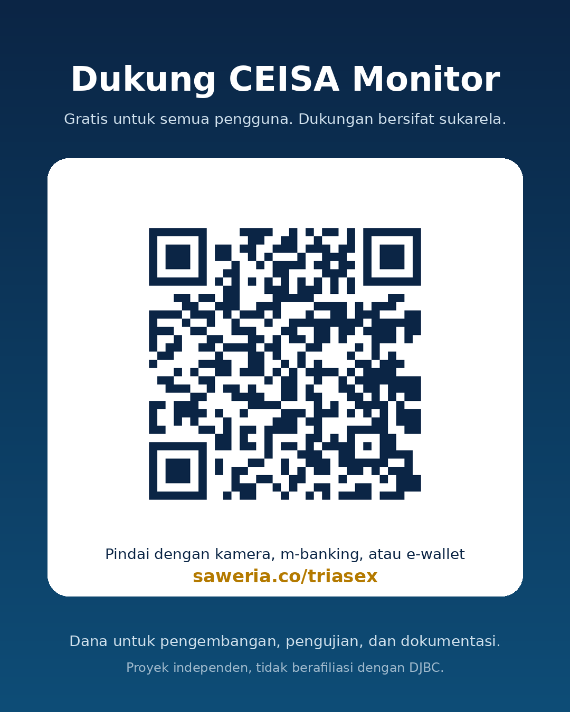</a> <b>Saweria</b> rupiah, QRIS, e-wallet</td>
<td align="center"> <b>Buy Me a Coffee</b> kartu dan mata uang asing</td>
</tr>
</table>

## Lisensi

Hak cipta © 2026 Trias Purwantoro. Hak cipta dilindungi. Repositori ini hanya berisi dokumentasi; kode ekstensi tidak dipublikasikan di sini. Ekstensi boleh dipasang dan dipakai untuk pekerjaan sendiri, tetapi tidak boleh disalin, diubah, diekstrak ulang, atau didistribusikan ulang tanpa izin tertulis. Lihat [LICENSE](LICENSE). Pustaka ExcelJS dan PptxGenJS memakai lisensi MIT masing-masing.

---

## English

CEISA Monitor 2.0 is a free Chrome and Edge extension for Indonesia's CEISA 4.0 customs portal. It reads the documents available to your account with your own login session and processes everything locally in the browser: no server, no stored passwords, read-only.

What 2.0 offers: a task-based dashboard (Summary, Documents, Billing, Value and duties, Follow-ups, Reports); a "Needs attention today" list where the Red Lane counts only while a document is still under inspection; documents filed under the old 15-digit NPWP merged into the same account, with stale documents (not final after more than a year) kept apart; reports that start from a purpose (monthly meeting, daily update, archive and audit, team tasks) and produce a concise meeting deck of about 15 slides, a formal A4 report with a one-page overview, a formatted Excel workbook, and a short or full WhatsApp message; a per-owner report with a WhatsApp message and Excel file per person whose filled-in Result column can be imported back; a document panel with stage timeline; optional background monitoring with an inbox (off by default); background refresh and document fetching for tens of thousands of documents; an office display mode, dark theme, and mobile layout.

The 2.0 interface is in Indonesian; English returns in a later version. Version 1 users are updated automatically by Chrome, with data and settings kept and a backup made first.

Install: only from the [Chrome Web Store](https://chromewebstore.google.com/detail/iojgnclbfhgoapolmfgcjkphacdfjbgi) (publisher: Trias EXIM). This repository holds documentation only. Try demo mode first if you do not have a CEISA account.

Independent project, not affiliated with Indonesian Customs (DJBC). All rights reserved; see [LICENSE](LICENSE).
