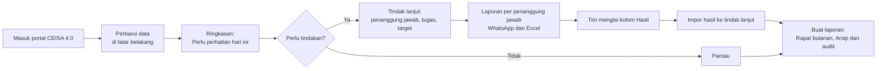

# Alur Kerja dengan CEISA Monitor 2.0

Contoh rutinitas tim ekspor-impor: harian, mingguan, dan bulanan. Sesuaikan dengan prosedur perusahaan Anda.

[Kembali ke README](../README.md) · [Panduan](PANDUAN.md) · [Video tutorial](TUTORIAL.md)

## Gambaran besar

Data hanya mengalir dari portal ke browser Anda. Ekstensi tidak mengubah apa pun di portal dan tidak mengirim data ke server.

## Harian (10–15 menit)

| Waktu | Langkah | Tempat |
|---|---|---|
| 08.00 | Masuk portal, buka CEISA Monitor, klik **Perbarui data** (atau biarkan Pemantauan bekerja bila dinyalakan) | Kepala dasbor |
| 08.05 | Baca kesimpulan dan **Perlu perhatian hari ini**: Jalur Merah dalam pemeriksaan, lebih dari 30 hari, dipantau, melewati SLA | Ringkasan |
| 08.10 | Buka tampilan **Belum ada penanggung jawab**, pilih dokumen, tetapkan penanggung jawab dan target | Dokumen |
| 08.15 | **Buat laporan → Tugas tim**: kirim pesan WhatsApp atau Excel ke setiap penanggung jawab | Laporan per penanggung jawab |
| 08.20 | **Buat laporan → Kabar harian**: salin pesan Singkat untuk atasan atau grup | Buat laporan |
| Sepanjang hari | Periksa lonceng (kotak masuk) untuk perubahan status bila Pemantauan menyala | Lonceng |
| Sore | **Impor hasil…** dari Excel yang diisi tim, atau ubah status tindak lanjut di panel dokumen | Laporan per penanggung jawab |

## Mingguan (Senin, 30 menit)

1. Tampilan **Melewati SLA** dan **Dokumen lama**: apa yang menumpuk dan mengapa?
2. Kartu **Tertahan di status** dan **Umur dokumen**: status mana yang paling lama?
3. Papan **Tindak lanjut**: kartu di kolom Menunggu pihak lain yang targetnya sudah lewat.
4. Kirim ulang laporan per penanggung jawab untuk dokumen yang belum selesai.
5. Buat cadangan **Ringan** (Pengaturan → Cadangan) agar tindak lanjut dan catatan aman.

## Bulanan (rapat, 15 menit persiapan)

1. Atur periode ke bulan yang dilaporkan di bilah filter.
2. Klik **Ambil isi** di Nilai dan pungutan agar bab pungutan lengkap.
3. **Buat laporan → Rapat bulanan**: presentasi, laporan resmi A4, dan Excel sekaligus.
4. Periksa slide **Temuan, usulan, dan keputusan yang dimohon**, lalu sesuaikan.
5. Lengkapi kop dan penanda tangan di laporan A4, klik **Ingat isian kop dan tanda tangan**, lalu cetak atau simpan sebagai PDF.

## Pembagian peran yang disarankan

| Peran | Tanggung jawab di CEISA Monitor |
|---|---|
| Supervisor EXIM | Membaca Perlu perhatian, menetapkan penanggung jawab dan target, mengirim laporan per penanggung jawab, mengimpor hasil, menyiapkan laporan bulanan |
| Staf dokumen | Menindaklanjuti tugas, mengisi kolom Hasil dan Keterangan di Excel |
| Koordinator gudang | Menangani tugas Gate In, Pembongkaran, Stuffing, dan pemeriksaan fisik Jalur Merah |
| Atasan | Menerima pesan Kabar harian dan laporan resmi bulanan |

Catatan tindak lanjut tersimpan di browser masing-masing. Untuk berbagi dengan rekan, gunakan berkas Excel per penanggung jawab atau cadangan Ringan.

## Menyesuaikan dengan perusahaan Anda

- **Profil perusahaan**: jenis fasilitas, status final, dan status Jalur Merah dalam pemeriksaan.
- **SLA**: pakai atau tidak, dan batas hari per jenis dokumen.
- **Data dan pembaruan**: jenis dokumen yang ditarik dan dokumen NPWP 15 digit.
- **Pemantauan**: nyalakan bila ingin perubahan status masuk ke lonceng tanpa menekan Perbarui data.
