# Panduan CEISA Monitor 2.0

[Kembali ke README](../README.md) · [Video tutorial](TUTORIAL.md) · [Alur kerja](ALUR_KERJA.md) · [Tanya jawab](FAQ.md)

Panduan ini untuk versi 2.0. Semua gambar memakai data fiktif berlabel DATA DEMO. Istilah yang dipakai sama dengan di dasbor: **belum selesai** berarti status selain status final, **umur dokumen** dihitung sejak tanggal pendaftaran, dan **Jalur Merah dalam pemeriksaan** hanya mencakup Penjaluran/Siap Jalur, Pemeriksaan Fisik/Barang, dan Penerimaan Dokumen Pelengkap.

## Daftar isi

1. [Sebelum mulai](#1-sebelum-mulai)
2. [Tarik data pertama](#2-tarik-data-pertama)
3. [Ringkasan](#3-ringkasan)
4. [Periode dan filter](#4-periode-dan-filter)
5. [Dokumen dan panel dokumen](#5-dokumen-dan-panel-dokumen)
6. [Tagihan](#6-tagihan)
7. [Nilai dan pungutan](#7-nilai-dan-pungutan)
8. [Tindak lanjut](#8-tindak-lanjut)
9. [Buat laporan](#9-buat-laporan)
10. [Laporan per penanggung jawab](#10-laporan-per-penanggung-jawab)
11. [Pemantauan dan kotak masuk](#11-pemantauan-dan-kotak-masuk)
12. [Pengaturan](#12-pengaturan)
13. [Popup, tombol portal, layar kantor, dan ponsel](#13-popup-tombol-portal-layar-kantor-dan-ponsel)

## 1. Sebelum mulai

- Chrome atau Microsoft Edge versi 116 atau lebih baru.
- Akun portal CEISA 4.0 milik Anda sendiri. CEISA Monitor tidak pernah masuk atas nama Anda; data dibaca dari tab portal yang Anda buka.
- Pasang **hanya** dari [Chrome Web Store](https://chromewebstore.google.com/detail/iojgnclbfhgoapolmfgcjkphacdfjbgi) (penerbit Trias EXIM), lalu sematkan ikonnya di bilah alat.

**Memperbarui dari versi 1.** Chrome memperbarui ekstensi otomatis. Sebelum perubahan apa pun, 2.0 membuat cadangan lengkap data versi 1 di browser (disimpan 60 hari dan dapat diunduh dari Pengaturan → Kesehatan). Data dokumen, tindak lanjut, kontak WhatsApp, dan pengaturan tetap terpakai. Pembaruan otomatis versi 1 dialihkan ke **Pemantauan** dengan selang terdekat, dan catatan pembaruan muncul sekali di lonceng. Tampilan English versi 1 belum tersedia di 2.0; dasbor tampil dalam bahasa Indonesia.

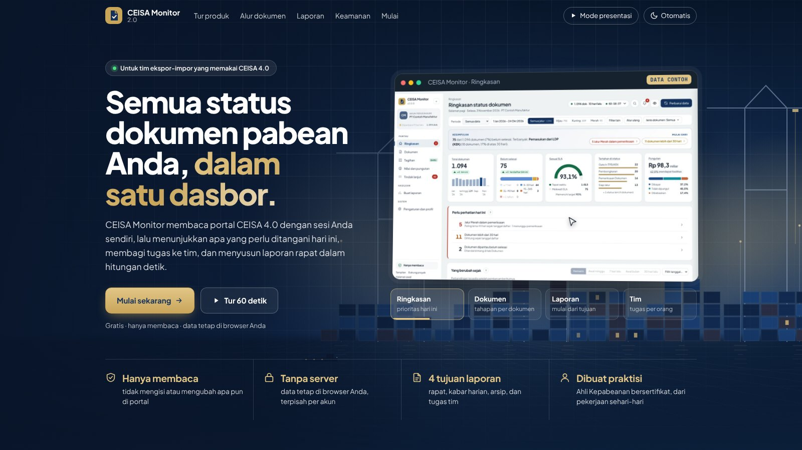

## 2. Tarik data pertama

1. Masuk ke portal CEISA 4.0 dan biarkan tabnya terbuka.
2. Buka CEISA Monitor dari ikon ekstensi atau tombol **CEISA Monitor** di halaman portal.
3. Klik **Perbarui data**. Penarikan berjalan di latar belakang: kemajuannya tampil di pil status di kepala halaman, dan Anda boleh membuka tab lain. Biarkan tab portal tetap terbuka sampai selesai.

Dokumen yang terdaftar dengan **NPWP 15 digit** (sebelum pergantian ke NITKU 22 digit) ikut ditarik dan digabung ke akun yang sama. Pilihan ini dapat dimatikan di Pengaturan → Data dan pembaruan.

Ingin melihat dulu tanpa portal? Pilih **Lihat mode demo** di halaman awal atau menu di kepala dasbor.

## 3. Ringkasan

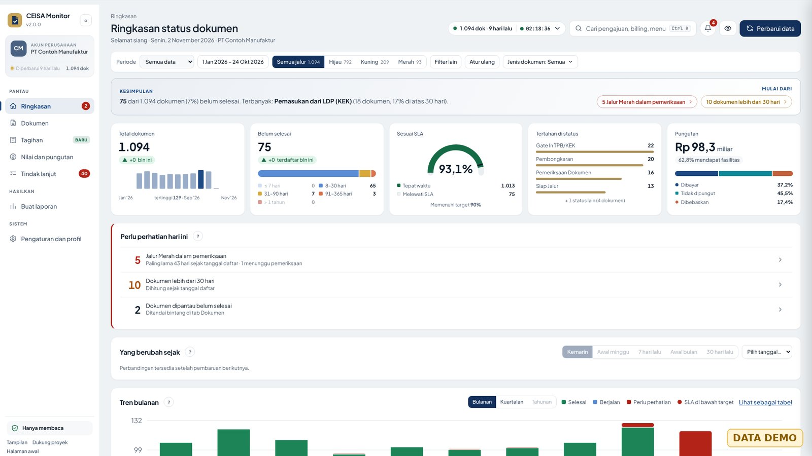

Bagian atas halaman berisi **kesimpulan** satu kalimat dan pintasan ke hal yang paling mendesak. Kartu angka utama:

| Kartu | Isi |
|---|---|
| Total dokumen | Jumlah dokumen per bulan dalam periode |
| Belum selesai | Jumlah dan sebaran umur dokumen belum selesai |
| Sesuai SLA | Persentase dokumen yang selesai atau masih dalam batas SLA, dengan penanda target |
| Tertahan di status | Status dengan dokumen belum selesai terbanyak |
| Pungutan | Total pungutan dari isi dokumen yang sudah diambil, dibayar dan berfasilitas |

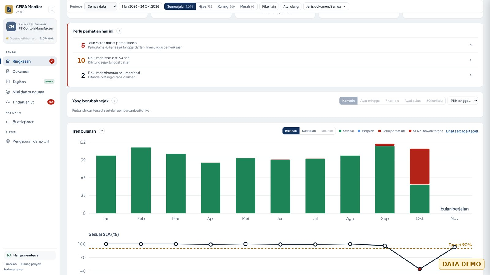

**Perlu perhatian hari ini** mengurutkan hal yang perlu ditangani: Jalur Merah dalam pemeriksaan, dokumen lebih dari 30 hari, dokumen dipantau yang belum selesai, dan dokumen yang melewati SLA. Baris dengan angka nol disembunyikan. Klik baris untuk membuka daftar dokumennya.

Di bawahnya ada **Tren bulanan**, **Per jenis dokumen**, **Penjaluran**, dan **Umur dokumen**. Klik jenis dokumen untuk membuka halaman jenis tersebut.

## 4. Periode dan filter

Bilah filter di atas setiap halaman berlaku untuk semua angka, tabel, dan laporan:

- **Periode**: Semua data, bulan, kuartal, tahun, atau rentang tanggal.
- **Jalur**: Semua jalur, Hijau, Kuning, atau Merah.
- **Jenis dokumen**: satu atau beberapa jenis.
- **Dokumen lama**: dokumen belum final yang berumur lebih dari 365 hari dipisahkan dari angka utama secara bawaan. Catatan di bilah filter menunjukkan jumlahnya, dengan pilihan **Lihat**, **Hitung semua**, atau **Buat Excel** untuk ditelusuri.

**Atur ulang** mengembalikan filter bawaan.

## 5. Dokumen dan panel dokumen

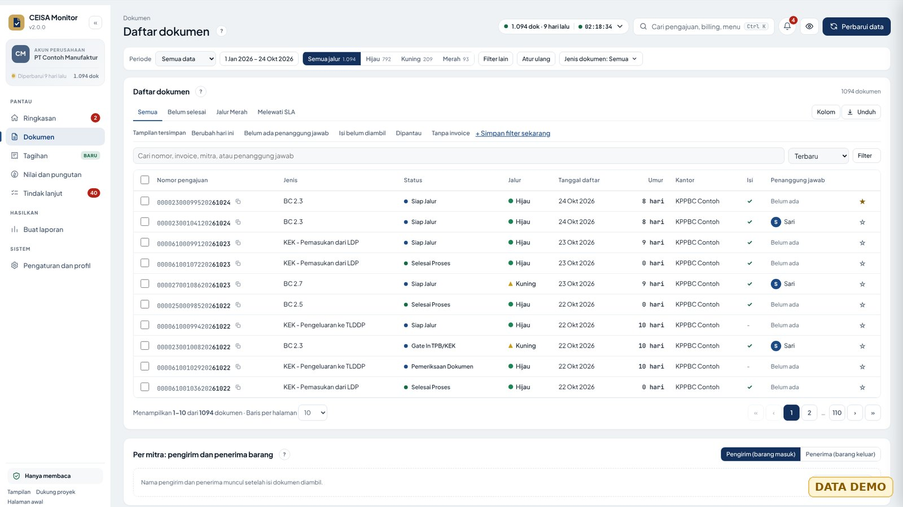

Tab di atas tabel: **Semua**, **Belum selesai**, **Jalur Merah**, dan **Melewati SLA**. Tampilan cepat: Berubah hari ini, Belum ada penanggung jawab, Isi belum diambil, Dipantau, dan Tanpa invoice. **Simpan filter sekarang** menyimpan kombinasi filter sebagai tampilan sendiri.

Kotak pencarian menerima nomor pengajuan, invoice, mitra, atau penanggung jawab. Tombol **Kolom** mengatur kolom, dan **Unduh** membuat Excel dari tabel yang tampil.

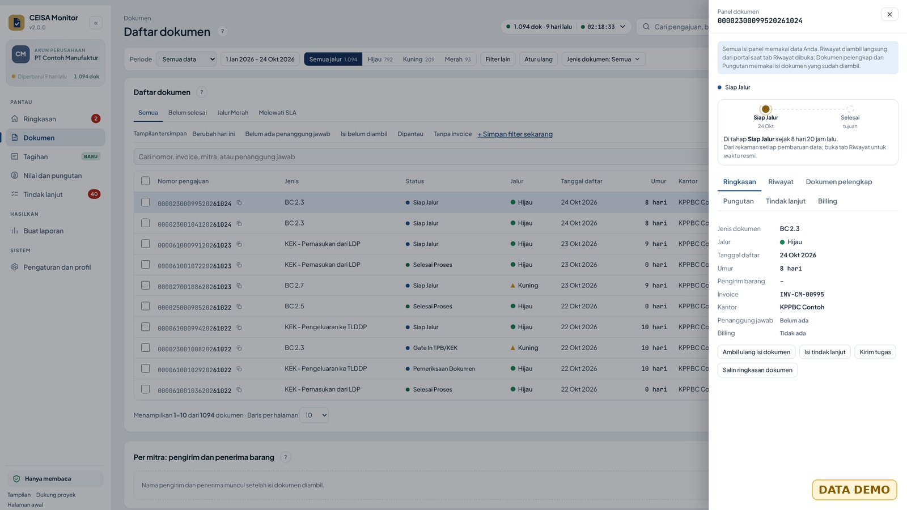

Klik baris untuk membuka **panel dokumen**:

- **Tahapan**: rel tahapan dari Riwayat Status portal dan lama di setiap status. Tombol **Ambil riwayat dari portal** membaca riwayat terbaru (nama dan NIP petugas tidak dibaca).
- **Isi**: dokumen pelengkap, barang, nilai, dan pungutan dari isi dokumen yang sudah diambil.
- **Tindak lanjut**: penanggung jawab, tugas, target, status tindak lanjut, catatan, dan pemeriksaan fisik untuk Jalur Merah.
- **Billing**: kode billing terkait dokumen beserta NTPN.

Tanda bintang memasukkan dokumen ke daftar **Dipantau**.

## 6. Tagihan

Daftar billing dari Browse Billing di portal, ditampilkan apa adanya: kode billing, nomor pengajuan, jenis, tenggat, nilai, status, dan NTPN. Rincian dan PDF billing diambil saat diklik dan tidak disimpan. CEISA Monitor tidak melakukan pembayaran dan tidak menilai billing mana yang harus dibayar.

## 7. Nilai dan pungutan

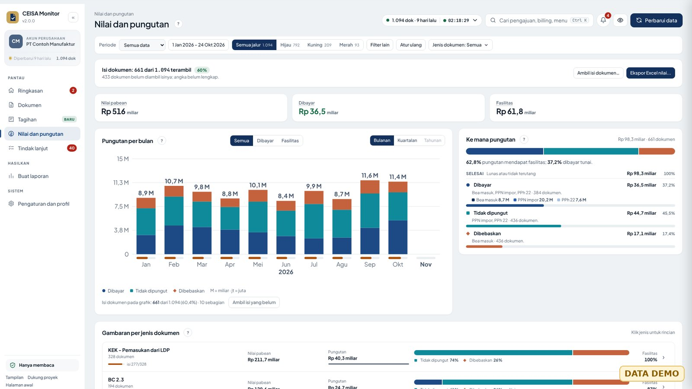

Angka di halaman ini dihitung dari **isi dokumen** yang diambil dari portal. Bagian atas menunjukkan berapa dokumen yang isinya sudah diambil; klik **Ambil isi** untuk melengkapinya. Pengambilan berjalan di latar belakang dan dapat dihentikan lalu dilanjutkan.

- **Kartu**: Nilai pabean, Dibayar, dan Fasilitas.
- **Pungutan per bulan**: Semua, Dibayar, atau Fasilitas, per bulan, kuartal, atau tahun. Bulan yang isinya belum diambil diberi arsiran, bukan ditulis nol.
- **Ke mana pungutan**: dibayar, tidak dipungut, ditangguhkan, dibebaskan, dan perlakuan lain, dengan nama perlakuan (bukan kode).
- **Per jenis dokumen**: komposisi perlakuan, besar pungutan, dan cakupan isi per jenis.

## 8. Tindak lanjut

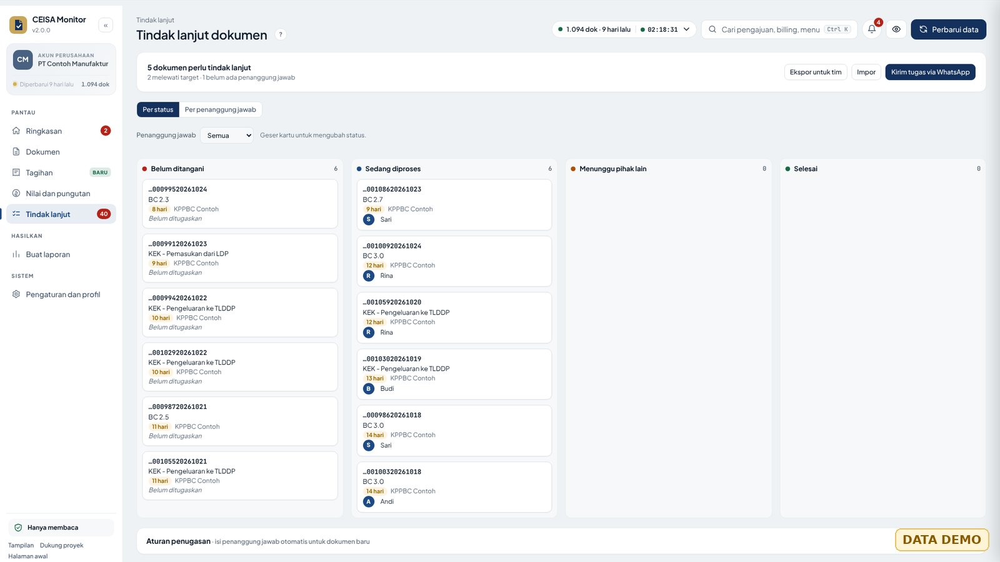

Papan tindak lanjut mengelompokkan dokumen belum selesai yang punya catatan menurut statusnya (Belum ditindaklanjuti, Sedang dicek, Menunggu pihak lain, Selesai dicek). Isi atau ubah tindak lanjut dari panel dokumen. Untuk banyak dokumen sekaligus, pilih baris di tabel Dokumen lalu atur penanggung jawabnya bersama.

## 9. Buat laporan

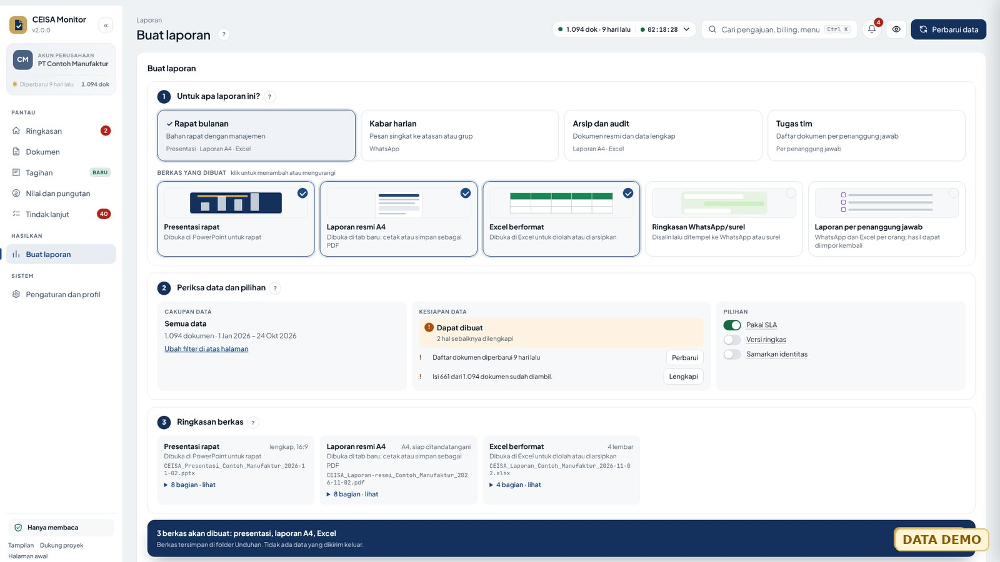

**Langkah 1. Untuk apa laporan ini?** Pilih tujuan, dan berkas yang cocok langsung terpilih:

| Tujuan | Berkas |
|---|---|
| Rapat bulanan | Presentasi, laporan resmi A4, Excel |
| Kabar harian | Pesan WhatsApp versi Singkat |
| Arsip dan audit | Laporan resmi A4 dan Excel |
| Tugas tim | Laporan per penanggung jawab |

Kartu berkas tetap dapat diklik untuk menambah atau mengurangi. Arahkan kursor ke kartu untuk melihat isinya.

**Langkah 2. Periksa data dan pilihan.** Cakupan mengikuti filter di atas halaman. Kesiapan data tampil sebagai satu tanda: **Data siap**, atau **Dapat dibuat** dengan hal yang sebaiknya dilengkapi (misalnya daftar dokumen sudah lama atau isi dokumen belum lengkap). Pilihan: **Pakai SLA**, **Versi ringkas**, dan **Samarkan identitas**.

**Langkah 3. Ringkasan berkas.** Satu baris per berkas: nama berkas persis seperti yang akan diunduh dan jumlah bagiannya. Klik **Buat** di bilah bawah. Berkas tersimpan di folder Unduhan; tidak ada data yang dikirim ke internet.

**Terakhir dibuat** menyimpan tiga pembuatan terakhir beserta pilihannya di browser ini. **Buat lagi** memakai pilihan yang sama dengan data terbaru.

### Presentasi rapat

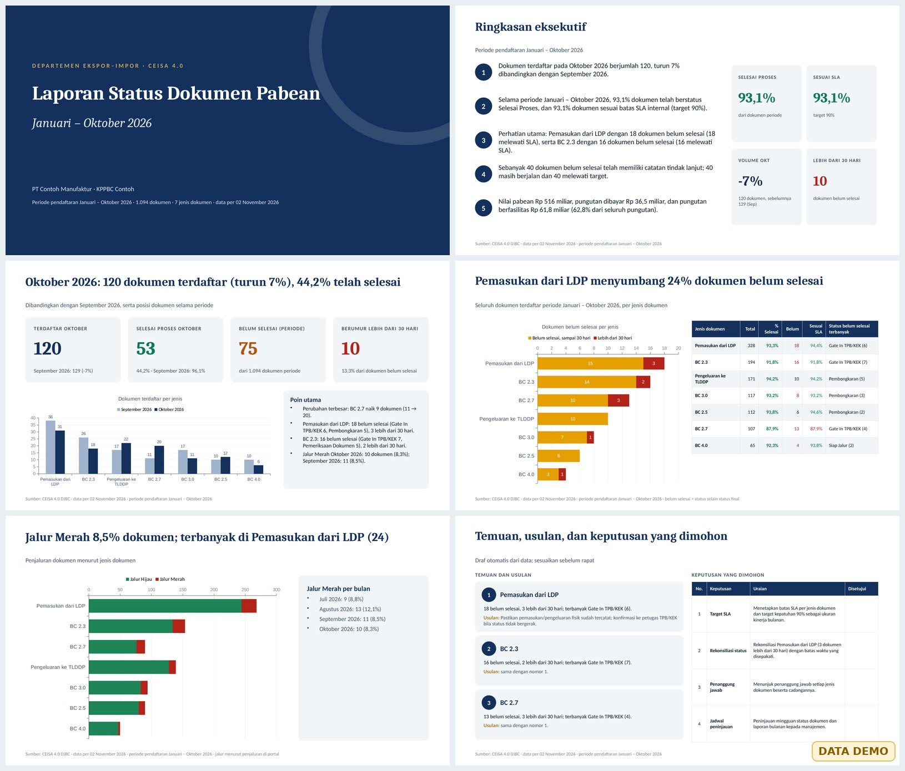

Sekitar 15 slide (versi ringkas sekitar 7). Judul setiap slide berupa kesimpulan, dan nama jenis dokumen ditulis tanpa kode. Isinya: ringkasan eksekutif, bulan terakhir dan volume per jenis, tren penyelesaian terhadap target, perbandingan jenis dokumen, umur dokumen, rincian paling banyak dua jenis yang perlu perhatian, waktu penyelesaian, penjaluran, nilai dan pungutan, tindak lanjut, temuan dan keputusan yang dimohon, serta lampiran.

### Laporan resmi A4

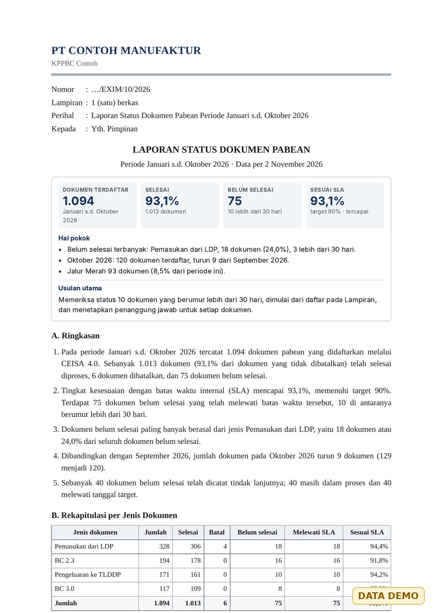

Dibuka di tab baru. Halaman pertama memuat **ikhtisar** (empat angka utama, hal pokok, dan usulan utama) sehingga dapat dibaca tanpa membuka halaman lain. Kolom bergaris putus-putus (nomor, kepada, kota, penanda tangan) dapat disunting langsung. **Ingat isian kop dan tanda tangan** menyimpan isian tersebut untuk laporan berikutnya. Cetak atau simpan sebagai PDF, atau unduh .doc.

### Excel berformat

Lembar Ringkasan, Per jenis (dengan Selesai, % Selesai, Lebih dari 30 hari, dan baris Jumlah), Dokumen (dokumen lebih dari 30 hari dan yang melewati SLA diberi tanda), serta Tagihan dan Nilai per jenis bila datanya ada. Semua lembar memakai filter dan baris kepala beku.

### Pesan WhatsApp

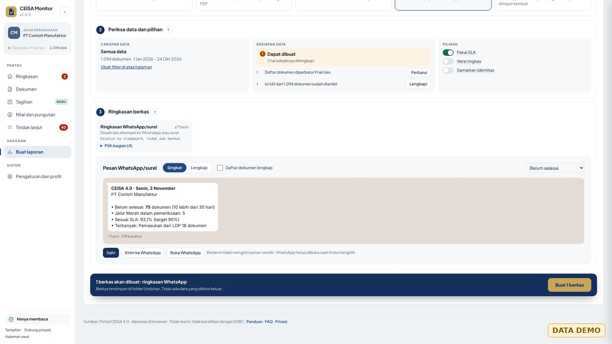

Pratinjau berupa gelembung pesan. Pilih **Singkat** (lima baris angka utama, untuk atasan) atau **Lengkap** (bagian yang dipilih, untuk tim). **Salin** menyalin teksnya; **Buka WhatsApp** membuka WhatsApp dengan teks tersebut, dan Anda sendiri yang memilih penerima dan menekan kirim.

## 10. Laporan per penanggung jawab

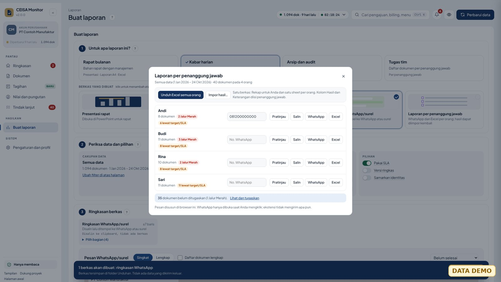

Dibuka dari tujuan **Tugas tim** atau dari papan Tindak lanjut. Setiap baris menunjukkan satu orang dengan jumlah dokumen belum selesai, Jalur Merah, dan yang lewat target atau SLA.

1. **Kirim.** Isi nomor WhatsApp (disimpan di browser ini), lalu **Pratinjau**, **Salin**, atau **WhatsApp**. Pesan tersusun menurut prioritas: Jalur Merah, lewat target, lalu lainnya, masing-masing dengan tugas yang disarankan. Tombol **Excel** membuat berkas khusus orang itu.
2. **Isi.** Penanggung jawab mengisi kolom **Hasil** (pilihan Selesai, Sedang diproses, Menunggu pihak lain, atau ketik bebas) dan **Keterangan** di Excel.
3. **Impor.** Klik **Impor hasil…** dan pilih berkas yang sudah diisi. Pratinjau menunjukkan apa yang akan berubah sebelum Anda menekan **Terapkan ke tindak lanjut**. Pilihan Hasil menjadi status tindak lanjut; teks bebas dan Keterangan menjadi catatan bertanggal. Dokumen yang dilaporkan Selesai tidak masuk laporan berikutnya.

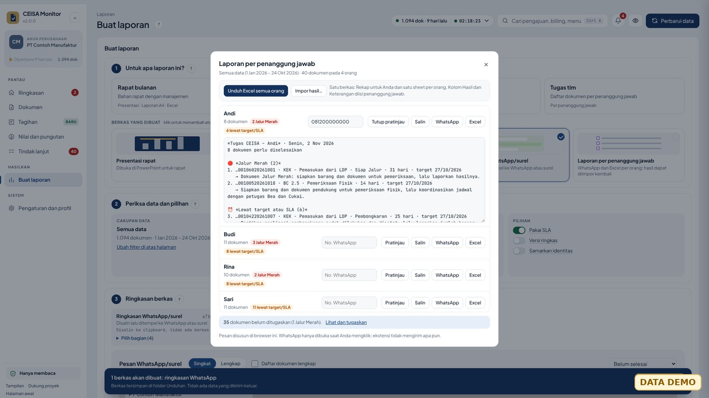

**Unduh Excel semua orang** membuat satu berkas berisi Rekap untuk Anda, satu sheet per orang, dan sheet Belum ditugaskan. Laporan dibuat kapan saja; tidak ada pengingat terjadwal.

## 11. Pemantauan dan kotak masuk

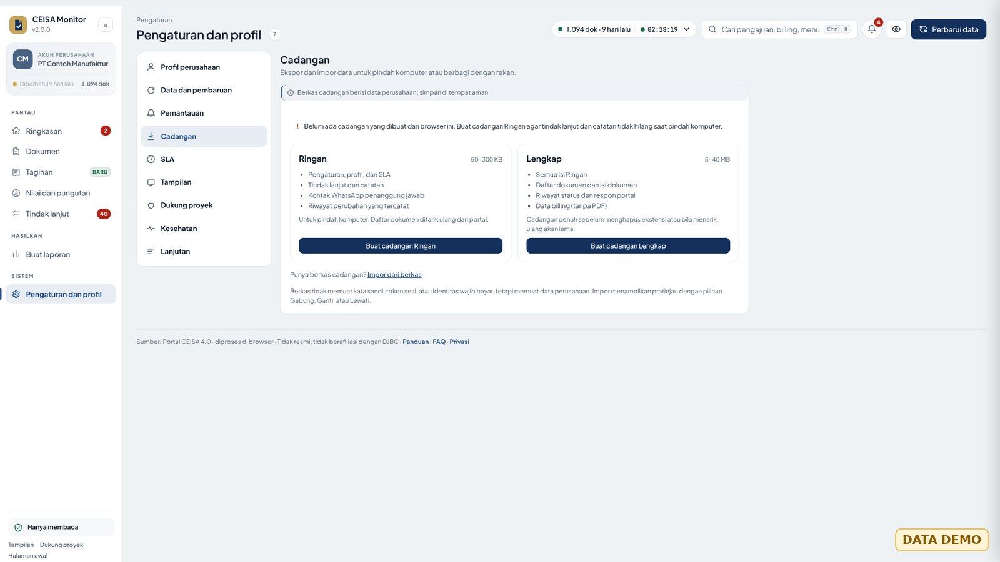

Pemantauan **mati secara bawaan**. Bila dinyalakan di Pengaturan → Pemantauan:

- **Pantau perubahan status** membaca daftar dokumen dalam rentang hari tertentu dengan selang 15, 30, atau 60 menit.
- **Pantau ketat** membaca riwayat status dan respons dokumen berbintang dan Jalur Merah dalam pemeriksaan yang belum selesai (paling banyak 50 dokumen) setiap 10 menit.
- Perubahan masuk ke **kotak masuk** di ikon lonceng. **Pemberitahuan browser** baru diminta izinnya saat Anda menyalakannya.

Pemantauan hanya berjalan bila tab portal terbuka dan Anda sudah masuk. Ekstensi tidak membuka tab portal sendiri, menjalankan permintaan satu per satu dengan jeda, dan berhenti bila sesi berakhir atau akun berbeda.

## 12. Pengaturan

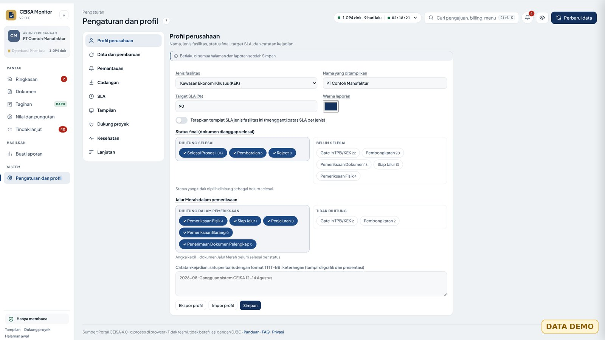

| Bagian | Isi |
|---|---|
| Profil perusahaan | Nama tampilan, jenis fasilitas, status final, status Jalur Merah dalam pemeriksaan, target SLA, catatan kejadian |
| Data dan pembaruan | Rentang tanggal dan jenis dokumen yang ditarik, serta dokumen NPWP 15 digit |
| Pemantauan | Pantau perubahan status, pantau ketat, dan pemberitahuan browser |
| Cadangan | Ekspor dan impor berkas `.ceisadata`: Ringan (pengaturan, profil, tindak lanjut, catatan, kontak) atau Lengkap (ditambah isi dokumen, riwayat, dan billing) |
| SLA | Pakai SLA atau tidak, dan batas hari per jenis dokumen |
| Tampilan | Tema Otomatis, Terang, atau Gelap; tingkat tampilan; tampilan menurut peran |
| Kesehatan | Status portal dan sesi, penarikan terakhir, data tersimpan, cadangan pembaruan, dan berkas diagnostik tanpa data pribadi |
| Lanjutan | Akun di browser ini (pakai atau hapus akun yang tidak dipakai), laporkan masalah, dan hapus semua data tersimpan |

Isian yang memakai tombol Simpan menampilkan bilah **Perubahan belum disimpan** di bawah layar. Saklar langsung tersimpan.

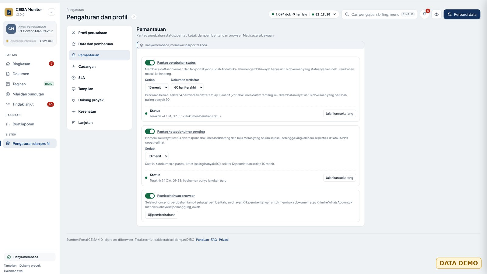

## 13. Popup, tombol portal, layar kantor, dan ponsel

- **Popup ikon**: ringkasan singkat, keadaan sesi portal, dan tombol membuka dasbor.
- **Tombol CEISA Monitor di halaman portal**: membuka dasbor; dapat disembunyikan.
- **Mode layar kantor**: tampilan layar penuh dengan huruf besar untuk monitor bersama, dengan pilihan menyamarkan nomor.
- **Tema gelap** dan **tampilan ponsel** dengan menu di bawah layar.

| Tema gelap | Ponsel |
|---|---|
| 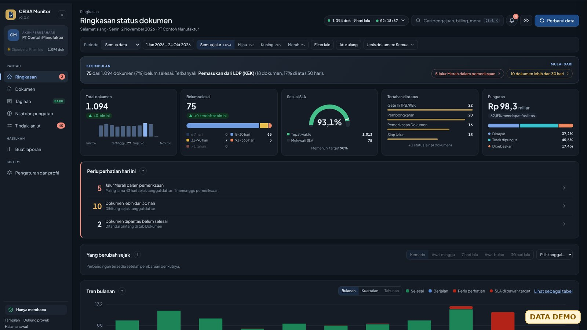 | 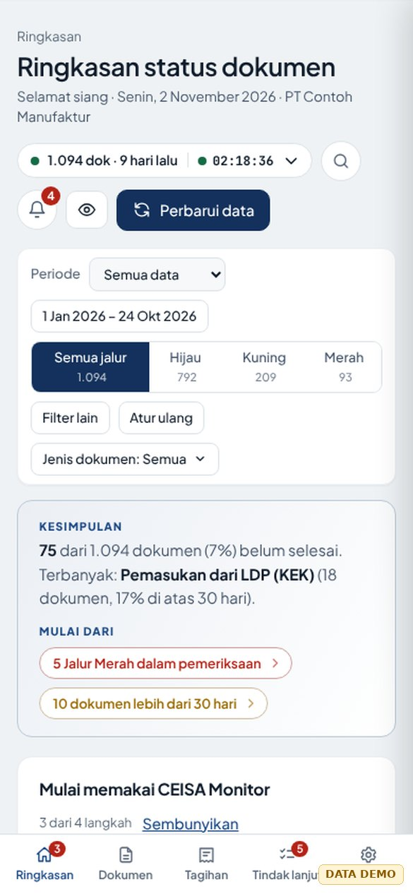 |

---

Butuh bantuan? Lihat [Tanya jawab](FAQ.md) atau buka [Issues](../../../issues/new/choose). Jangan melampirkan data asli perusahaan atau tangkapan layar portal yang memuat data rahasia.
