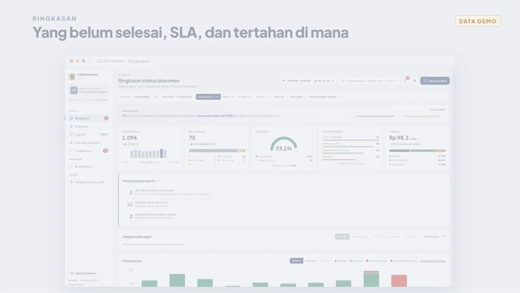
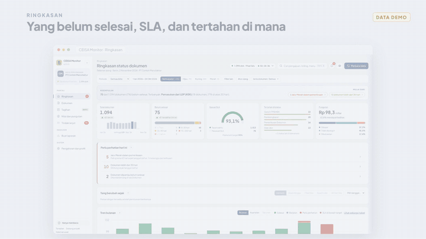
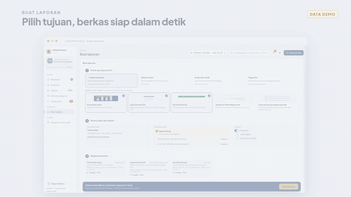
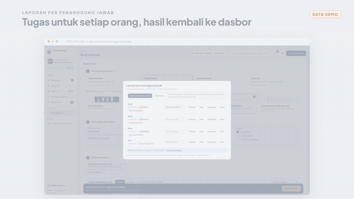

# Video tutorial CEISA Monitor 2.0

[Kembali ke README](../README.md) · [Panduan bergambar](PANDUAN.md)

Semua video bernarasi bahasa Indonesia dan memakai data fiktif berlabel DATA DEMO. Berkas video ada di rilis [v2.0.0](../../../releases/tag/v2.0.0).

## Perkenalan (38 detik)

[CEISA_Monitor_2.0_Store.mp4](../../../releases/download/v2.0.0/CEISA_Monitor_2.0_Store.mp4): Ringkasan, Perlu perhatian, Buat laporan, laporan per penanggung jawab, dan prinsip keamanan.

## Seri "Belajar CEISA Monitor 2.0"

| Bab | Isi | Panduan tertulis |
|---|---|---|
| [1. Memasang dan menarik data pertama](../../../releases/download/v2.0.0/Tutorial_01_Memasang_dan_menarik_data.mp4) | Pasang dari Chrome Web Store, pembaruan dari versi 1, Perbarui data di latar belakang, NPWP 15 digit, Profil perusahaan | [Bagian 1–2](PANDUAN.md#1-sebelum-mulai) |
| [2. Ringkasan dan Perlu perhatian](../../../releases/download/v2.0.0/Tutorial_02_Ringkasan_dan_Perlu_perhatian.mp4) | Kesimpulan, kartu angka utama, Perlu perhatian hari ini, filter, dokumen lama | [Bagian 3–4](PANDUAN.md#3-ringkasan) |
| [3. Dokumen dan tindak lanjut](../../../releases/download/v2.0.0/Tutorial_03_Dokumen_dan_tindak_lanjut.mp4) | Tampilan, pencarian, panel dokumen, tahapan, isian tindak lanjut, papan Tindak lanjut | [Bagian 5 dan 8](PANDUAN.md#5-dokumen-dan-panel-dokumen) |
| [4. Buat laporan](../../../releases/download/v2.0.0/Tutorial_04_Buat_laporan.mp4) | Tujuan, kesiapan data, presentasi rapat, laporan resmi A4, Excel, pesan WhatsApp, Terakhir dibuat | [Bagian 9](PANDUAN.md#9-buat-laporan) |
| [5. Laporan per penanggung jawab](../../../releases/download/v2.0.0/Tutorial_05_Laporan_per_penanggung_jawab.mp4) | Pesan WhatsApp dan Excel per orang, kolom Hasil, Impor hasil | [Bagian 10](PANDUAN.md#10-laporan-per-penanggung-jawab) |
| [6. Pengaturan, Pemantauan, dan Cadangan](../../../releases/download/v2.0.0/Tutorial_06_Pengaturan_Pemantauan_Cadangan.mp4) | Bagian Pengaturan, Pemantauan dan kotak masuk, cadangan, akun, tema dan layar kantor | [Bagian 11–13](PANDUAN.md#11-pemantauan-dan-kotak-masuk) |

Setiap bab berdurasi sekitar satu menit, dengan teks di layar sehingga dapat diikuti tanpa suara. Klik judul bab untuk membuka videonya.

**Video lengkap (5 menit):** [Tutorial_lengkap_CEISA_Monitor_2.0.mp4](../../../releases/download/v2.0.0/Tutorial_lengkap_CEISA_Monitor_2.0.mp4)

| Waktu | Bab |
|---|---|
| 0:00 | 1. Memasang dan menarik data pertama |
| 1:00 | 2. Ringkasan dan Perlu perhatian hari ini |
| 1:46 | 3. Dokumen, panel dokumen, dan tindak lanjut |
| 2:31 | 4. Buat laporan: mulai dari tujuan |
| 3:22 | 5. Laporan per penanggung jawab |
| 4:09 | 6. Pengaturan, Pemantauan, dan Cadangan |

| Ringkasan | Buat laporan | Laporan per penanggung jawab |
|---|---|---|
|  |  |  |

Video versi 1 tetap tersedia di rilis lama, misalnya [v1.17.0](../../../releases/tag/v1.17.0).
